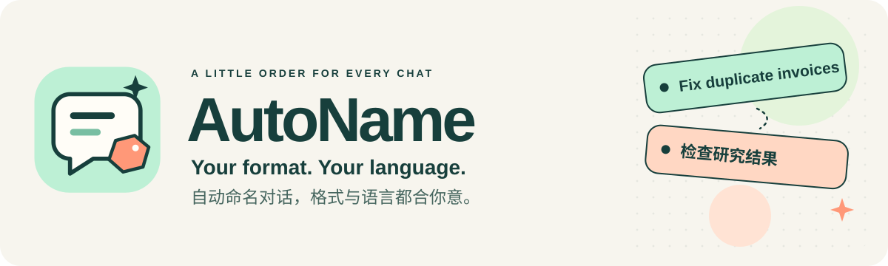
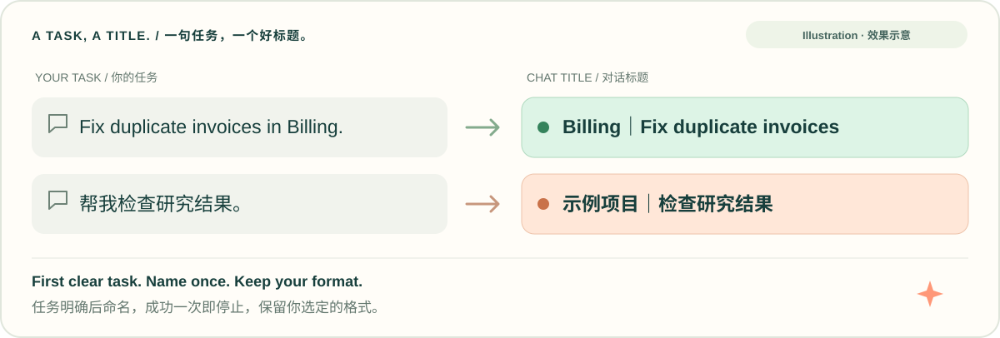

<p align="center">
  
</p>

<p align="center">
  
  
  
</p>

<p align="center">
  <b>Automatic chat titles in your format and conversation language.</b><br />
  Guided setup and extensible agent integrations.<br /><br />
  <b>自动命名对话，格式自定、语言随对话。</b><br />
  支持引导配置与可扩展的智能体适配。
</p>

<p align="center">
  <a href="#english">English</a> · <a href="#中文">简体中文</a> · <a href="INSTALL.md">🚀 Installation / 安装</a> · <a href="skills/autoname/references/adapters.md">🧩 Adapters / 适配</a>
</p>

## English

AutoName names agent conversations from their actual task. Choose your format during first-time setup; titles then follow the language of each conversation. Naming reuses the current agent model and local host interfaces, with no separate model API request.



<details>
<summary>Text examples</summary>

| Conversation | Example title |
| --- | --- |
| “Fix duplicate invoices in Billing.” | `Billing｜Fix duplicate invoices` |
| “帮我检查研究结果。” | `示例项目｜检查研究结果` |
| A task without a verified project | `Review results` |

</details>

The examples use a suggested format. Field order, separators, literal prefixes, project aliases, and title length are configurable.

### ✨ What's included

- A reusable skill with first-install setup instructions.
- An interactive installer and structured commands for agent-led setup.
- Validated title templates and conversation-language guidance.
- Codex lifecycle integration, an optional Claude Code SDK writer, a WorkBuddy on-demand adapter, and extensible adapter descriptors.
- Safe reconfiguration, disable/enable, installation checks, and owned-file uninstall.
- Portable source, npm, and skill ZIP packages checked for private data.

**Verification:** installation and lifecycle behavior are tested in isolated host fixtures. The Claude SDK boundary uses a test double. A user-supplied Windows WorkBuddy test handoff dated 2026-11-03 reported successful native title writes; the corrected helper workflow is covered by synthetic-receipt tests and still needs a live WorkBuddy rerun. Native desktop/CLI behavior needs a new-chat check in the target host.

### 🚀 Get started

Choose guided npx, a standard skill manager, a persistent npm command, Python/source, or the portable ZIP. All entries share the same preferences and hook implementation. Full commands and publication status are in [installation options](INSTALL.md).

Start guided setup directly from GitHub:

```bash
npx --package='github:SuperStevenDing/AutoName' autoname
```

To install the skill through the standard manager:

```bash
npx skills add 'SuperStevenDing/AutoName' --skill autoname
```

To run directly with Python:

```bash
python3 skills/autoname/scripts/autoname.py
```

The guided terminal entries ask for a target agent, format, no-project fallback, and length limit. Inspect the previews and save. The installer copies the skill and, in automatic mode, merges its hooks while retaining unrelated settings. A standard skill-manager import runs setup on first use and uses in-place configuration for files or links the manager already owns. WorkBuddy requires explicit `--mode on-demand` and `--host-root`; see [installation options](INSTALL.md).

For an agent-led installation, ask your agent to use the [AutoName skill](skills/autoname/SKILL.md). The agent collects the same choices through its own question form or conversation. A non-interactive installer returns `setup_required` instead of silently accepting a format. File-only imports start setup when you first invoke the skill.

The base helpers need Python 3.9 or later and no third-party packages. Guided npx also needs Node.js 18 or later. Run Python commands with the interpreter you want the installed hooks to use. After installation, reload the host if needed and complete its native hook trust steps.

### 🎛️ Pick your format

| Style | Template |
| --- | --- |
| Task only | `{task}` |
| Project first | `{project}｜{task}` |
| Task first | `{task} · {project}` |
| Custom literal text | `Research / {project} / {task}` |

You can describe a format to the installing agent in plain language. The two template fields are `{project}` and `{task}`. Unknown fields and executable format expressions are rejected. A separate fallback controls chats without a verified project.

The project-first template and 36 characters are suggestions. An overlong generated title is rejected so the agent can shorten its wording without changing your chosen format. New settings affect future naming rather than batch-renaming old chats.

Chinese tasks produce Chinese task descriptions; English tasks produce English descriptions. Other languages use the same rule, subject to the host model's abilities. Mixed-language tasks follow the main instruction language. Proper names, configured project aliases, and literal template text stay intact. No language pack or extra language selection is required.

### 🧰 Check and manage installation

```bash
python3 skills/autoname/scripts/autoname.py status --host codex
python3 skills/autoname/scripts/autoname.py configure --host codex --template '{task} · {project}'
python3 skills/autoname/scripts/autoname.py disable --host codex
python3 skills/autoname/scripts/autoname.py enable --host codex
python3 skills/autoname/scripts/autoname.py uninstall --host codex
```

`configured_pending_host_check` means local registration is complete. `verified` records a confirming title result; `incomplete` means the installed files, registration, or writer dependency need attention. Installing again preserves existing preferences, including a disabled switch. Use `enable` to request automatic naming again.

The preference switch is shared across installed adapters. Uninstall keeps preferences and removes only AutoName-owned, unmodified files and hook handlers. User edits and unrelated hooks remain.

Preferences live under the user's configuration directory, in `autoname/preferences.json` (`AutoName` under `%APPDATA%` on Windows). Each host has separate registration and runtime state. `--data-dir`, `--host-root`, and `--skills-dir` let an installing agent select explicit locations, including project-scoped ones. Host settings and runtime data stay outside the distributed skill.

### 🧩 Agent integration

AutoName uses open-ended adapter registration. Additional agents reuse the same preferences and naming rules.

| Integration | Implementation | Validation |
| --- | --- | --- |
| Codex desktop | Built-in hooks and native `set_thread_title` confirmation. | Isolated lifecycle and installation fixtures; live new-chat check required. |
| Claude Code | Built-in hook schema and official Agent SDK `rename_session`/`get_session_info`. | SDK boundary tests; compatible SDK must be installed in the selected interpreter; live host check required. |
| WorkBuddy | Built-in native `workbuddy_app_set_conversation_title` adapter with nested receipt confirmation; on-demand and suggestion modes. | Windows native writes reported in the user's test handoff; corrected flow tested with synthetic receipts; live rerun required. No verified lifecycle schema, so automatic mode is unavailable. |
| Other agents | Explicit descriptor plus a supported native tool, local JSON bridge, or suggestion mode. | Host interfaces must be discovered and tested for each integration. |

For Claude Code, install a compatible official `claude-agent-sdk` package in the interpreter used by AutoName, then use `install --host claude-code`. AutoName only uses local session metadata methods; it does not start a second model conversation. Existing custom titles are preserved.

For WorkBuddy, use `install --host workbuddy --mode on-demand --host-root <actual-root>` with the user's chosen preferences. No private adapter descriptor is needed. If the current conversation ID is initially unavailable, render the title, call the native tool without `conversationId`, then prepare and confirm with the ID returned in `conversation.conversationId`. See [the WorkBuddy guide](skills/autoname/references/workbuddy.md) for installation, existing-install migration, and the live check. A workspace folder name does not establish a conversation ID or project membership.

For another agent, start with [adapter.example.json](skills/autoname/assets/adapter.example.json). Set its identifier, verified hook schema, and title interface; pass `--host`, `--adapter`, and `--host-root` explicitly. A custom local bridge receives JSON on stdin and must confirm the exact session and title. See [the adapter guide](skills/autoname/references/adapters.md).

Automatic mode requires a recurring trigger and a confirming title writer. If either is unavailable, the user can explicitly choose on-demand naming or title suggestions. Suggestions are never recorded as applied titles. Native Windows hook command behavior has not been live-tested; validate the selected host's shell before enabling automatic mode there.

### 🔒 Naming behavior and privacy

AutoName waits for a clear task, respects an explicit user title, and stops automatic naming after one confirmed success. Resumed older chats and subagents are not enrolled. Failures leave the main user task running.

The distributed skill contains generic examples, not the author's personal paths, project list, chat history, credentials, or runtime configuration. Hook payloads are not logged. Component-owned state stores hashed session keys, the working directory needed by the host writer, and a pending title until confirmation. Local settings backups and preferences remain private to the installation and are excluded from release archives.

### 📦 Package contents

The source download includes the skill, Python helpers, Node launcher, installation guide, and README images. The npm package includes the same skill and launcher. The standalone skill ZIP contains an `autoname/` folder and ships with a SHA-256 checksum. Packages are checked for personal paths, account identifiers, emails, credentials, runtime data, and private archive metadata.

Read [setup](skills/autoname/references/setup.md), [commands](skills/autoname/references/commands.md), and [architecture](skills/autoname/references/architecture.md). GitHub installation is available. AutoName uses the [MIT License](LICENSE); npm registry publication is pending.

## 中文

AutoName 根据实际任务为智能体对话命名。首次安装时选择格式，后续标题跟随每次对话的语言。命名复用当前智能体模型和本地宿主接口，不额外发起模型 API 请求。


<details>
<summary>文字示例</summary>

| 对话内容 | 标题示例 |
| --- | --- |
| “帮我检查研究结果。” | `示例项目｜检查研究结果` |
| “Fix duplicate invoices in Billing.” | `Billing｜Fix duplicate invoices` |
| 任务明确，但没有可核实的项目归属 | `检查研究结果` |

</details>

示例采用建议格式。字段顺序、分隔符、固定前缀、项目别名和标题长度均可配置。

### ✨ 已包含的内容

- 可复用的 skill 和首次安装引导。
- 交互式安装器，以及供智能体调用的结构化配置命令。
- 经过校验的标题模板和跟随对话语言的命名规则。
- Codex 生命周期接入、可选的 Claude Code SDK 改名接口、WorkBuddy 按需命名适配，以及可扩展的适配描述文件。
- 配置修改、停用与启用、安装检查，以及按文件归属卸载。
- 经过隐私检查的源码、npm 和独立技能 ZIP 安装包。

**验证范围：**安装和生命周期行为已在隔离的宿主测试环境中验证；Claude SDK 边界采用测试替身。用户提供的 2026-11-03 Windows WorkBuddy 实测交接材料报告了原生标题写入成功；修正后的工具流程已通过模拟回执测试，仍需在 WorkBuddy 中重新实测。桌面端或 CLI 的表现需要在目标宿主的新对话中验证。

### 🚀 开始使用

可以选择引导式 npx、标准技能安装器、全局 npm 命令、Python／源码或独立 ZIP。各入口复用同一份偏好和 hook 实现。完整命令及发布状态见[安装方式](INSTALL.md)。

直接从 GitHub 运行安装向导：

```bash
npx --package='github:SuperStevenDing/AutoName' autoname
```

通过标准技能安装器安装：

```bash
npx skills add 'SuperStevenDing/AutoName' --skill autoname
```

直接使用 Python：

```bash
python3 skills/autoname/scripts/autoname.py
```

引导式终端入口会询问安装目标、命名格式、无项目备用格式及长度上限。查看预览后保存，安装器复制技能，并在自动模式下合并自身的 hook，保留其他设置。标准技能安装器导入的文件或链接，在首次使用时通过原地配置完成接入，继续由原安装器管理。WorkBuddy 需要显式传入 `--mode on-demand` 和 `--host-root`，见[安装方式](INSTALL.md)。

也可以让智能体使用 [AutoName 技能](skills/autoname/SKILL.md)完成安装。它会通过宿主的提问表单或对话收集相同选择。非交互安装缺少格式时，返回 `setup_required`，不会静默接受预设。仅导入文件的渠道，在首次调用技能时进入配置。

基础工具需要 Python 3.9 或更高版本，无第三方依赖。引导式 npx 还需要 Node.js 18 或更高版本。执行 Python 命令时，使用你希望 hook 调用的同一个解释器。安装后按需重新加载宿主，并完成宿主自身要求的 hook 信任步骤。

### 🎛️ 定义命名格式

| 样式 | 模板 |
| --- | --- |
| 只写任务 | `{task}` |
| 项目在前 | `{project}｜{task}` |
| 任务在前 | `{task} · {project}` |
| 自定义固定文字 | `研究 / {project} / {task}` |

可以用自然语言向安装智能体描述格式。模板字段为 `{project}` 和 `{task}`，未知字段和可执行的格式表达式会被拒绝。另设备用模板，处理没有可核实项目归属的对话。

“项目在前”和 36 个字符都是建议值。生成标题过长时，工具会要求智能体缩短措辞，保留用户指定的格式。修改设置影响后续命名，不批量改写旧对话。

中文任务用中文任务描述，英文任务用英文描述。其他语言遵循相同规则，具体能力取决于宿主模型。中英混合时采用主要指令的语言。专名、已配置的项目别名及模板固定文字保留原样，无需单独安装语言包或选择语言。

### 🧰 检查和管理安装

```bash
python3 skills/autoname/scripts/autoname.py status --host codex
python3 skills/autoname/scripts/autoname.py configure --host codex --template '{task} · {project}'
python3 skills/autoname/scripts/autoname.py disable --host codex
python3 skills/autoname/scripts/autoname.py enable --host codex
python3 skills/autoname/scripts/autoname.py uninstall --host codex
```

`configured_pending_host_check` 表示本地注册已完成；`verified` 表示已收到一次标题写入确认；`incomplete` 表示安装文件、注册或写入依赖需要检查。重复安装保留已有偏好，包括已经停用的开关；需要恢复自动命名时使用 `enable`。

偏好开关由已安装的适配器共用。卸载保留偏好，只移除 AutoName 自己注册的 hook 和未修改的自有文件，保留用户修改及其他 hook。

偏好存放在用户配置目录中的 `autoname/preferences.json`，Windows 使用 `%APPDATA%` 下的 `AutoName`。各宿主分别保存注册和运行状态。安装智能体可通过 `--data-dir`、`--host-root` 和 `--skills-dir` 指定位置，包括项目级位置。宿主设置和运行数据均位于分发技能目录之外。

### 🧩 智能体接入

AutoName 使用开放式适配注册，其他智能体复用同一份命名偏好和规则。

| 接入目标 | 已实现内容 | 验证状态 |
| --- | --- | --- |
| Codex 桌面端 | 内置 hooks 及原生 `set_thread_title` 结果确认。 | 已通过隔离的生命周期和安装测试，仍需实际新对话验证。 |
| Claude Code | 内置 hook 结构，以及官方 SDK 的 `rename_session`、`get_session_info`。 | 已通过 SDK 边界测试；所选解释器需安装兼容 SDK，仍需实际宿主验证。 |
| WorkBuddy | 内置原生 `workbuddy_app_set_conversation_title` 适配及嵌套回执确认，支持按需命名和标题建议。 | 用户交接材料报告了 Windows 原生写入成功；修正流程已通过模拟回执测试，仍需宿主重测。生命周期结构尚未核实，自动模式不可用。 |
| 其他智能体 | 显式适配描述文件，接入宿主原生工具、本地 JSON 桥接或标题建议模式。 | 各平台分别发现接口并验证。 |

Claude Code 需要在 AutoName 使用的解释器中安装兼容的官方 `claude-agent-sdk`，然后执行 `install --host claude-code`。AutoName 只使用本地会话元数据方法，不另开模型对话，并保留已有自定义标题。

WorkBuddy 使用 `install --host workbuddy --mode on-demand --host-root <actual-root>`，并传入用户选择的偏好，无需私有适配描述文件。如果调用前拿不到真实会话 ID，先渲染标题并调用原生工具，省略 `conversationId`，再用回执中 `conversation.conversationId` 的值执行准备和确认。[WorkBuddy 指南](skills/autoname/references/workbuddy.md)包含安装、已有配置迁移及实际宿主验证步骤。工作区目录名不能证明会话 ID 或项目归属。

其他智能体可从 [adapter.example.json](skills/autoname/assets/adapter.example.json) 开始，填写标识、已核实的 hook 结构和标题接口，并显式传入 `--host`、`--adapter`、`--host-root`。本地桥接通过标准输入接收 JSON，必须确认完全一致的会话和标题。详见[适配指南](skills/autoname/references/adapters.md)。

自动模式需要持续触发机制和可确认的标题写入能力。能力缺失时，用户可以明确选择按需命名或标题建议；建议不会被记录为已改名。Windows 原生 hook 命令尚未经实际宿主测试，在该环境启用自动模式前需验证宿主的命令解释方式。

### 🔒 命名行为与隐私

AutoName 等待任务明确后命名，尊重用户指定的标题，自动命名成功一次后停止。恢复的旧对话及子智能体不会被登记；命名失败时继续用户的主要任务。

分发技能仅包含通用示例，不包含作者个人路径、项目清单、聊天历史、凭据或实际运行配置。hook 不记录原始输入。组件自己的状态库保存会话标识的哈希、宿主改名所需的工作目录，以及确认前的待写标题。本地设置备份和偏好属于私有安装数据，发布包会排除这些内容。

### 📦 安装包内容

源码包包含技能、Python 工具、Node 入口、安装说明和 README 图片。npm 包包含同一套技能及命令入口。独立技能 ZIP 内含 `autoname/` 文件夹，并附 SHA-256 校验文件。安装包检查个人路径、账户标识、邮箱、凭据、运行数据和私有归档元数据。

完整说明见[首次配置](skills/autoname/references/setup.md)、[命令](skills/autoname/references/commands.md)和[架构](skills/autoname/references/architecture.md)。GitHub 安装入口已可使用；AutoName 采用 [MIT 许可证](LICENSE)，npm 注册包尚未发布。
